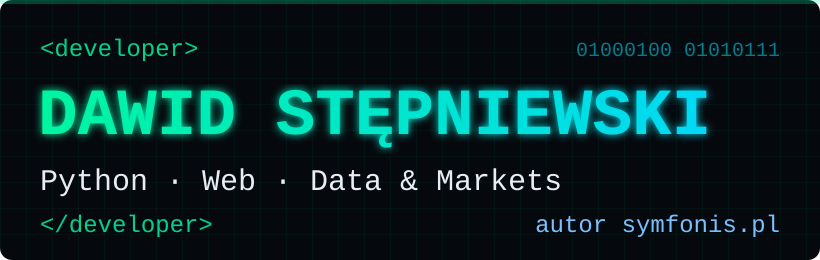
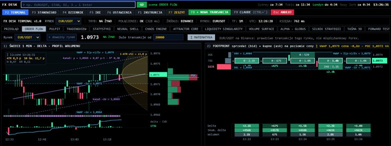
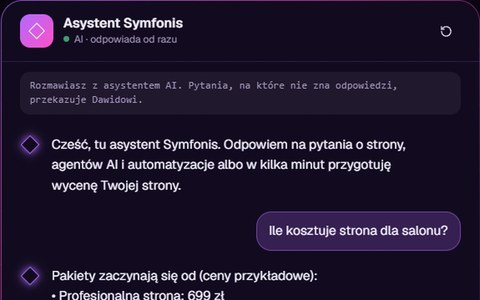
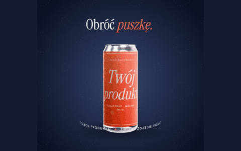

Buduję strony internetowe, narzędzia do analizy rynku i automatyzacje z AI. Uczę się Pythona (PCAP) i finansów (CFA Investment Foundations).

Jestem autorem strony **[symfonis.pl](https://symfonis.pl)**: projekt, sklep z płatnościami Stripe i czat, który sam liczy wycenę.

### Wykształcenie

**Technikum informatyczne**

### Kursy i certyfikaty

| Kurs | Gdzie | Stan |
|---|---|---|
| PCAP: Certified Associate Python Programmer | Python Institute | w trakcie |
| CFA Investment Foundations | CFA Institute | w trakcie |
| Asystent księgowości | kik.pl | ukończony ✅ |
| AI, Excel, bazy danych | techniczni.pro | ukończone ✅ |

### Teraz pracuję nad

- **FX Desk:** 15 nowych rynków (złoto, waluty egzotyczne, krypto), ponad 1000 testów automatycznych.
- **symfonis.pl:** płatności Stripe na żywo, czat z 58 tematami, który rozumie literówki.

### Projekty

<table>
<tr>
<td width="50%" valign="top">

 <b>FX Desk: terminal do analizy rynku</b> 
Dane z giełdy na żywo, order flow, wolumen na poziomach ceny i statystyki w stylu Bloomberga. JavaScript i Python. 
Narzędzie do nauki, bez sygnałów kupna i sprzedaży.
</td>
<td width="50%" valign="top">

 <b>Czat z wyceną i płatnością</b> 
Odpowiada na pytania klientów, liczy wycenę i otwiera płatność Stripe. Działa na symfonis.pl. 
<a href="https://symfonis.pl">Wypróbuj</a>
</td>
</tr>
<tr>
<td width="50%" valign="top">

 <b>Strona hotelu z filmem AI</b> 
Film z AI odtwarza się przy przewijaniu: od przylotu do kolacji na plaży. 
<a href="https://symfonis.pl/realizacje/hotel/">Demo</a>
</td>
<td width="50%" valign="top">

 <b>Produkt w 3D (three.js)</b> 
Puszka obraca się przy przewijaniu i zmienia smak, z koszykiem. 
<a href="https://symfonis.pl/realizacje/napoje/">Demo</a>
</td>
</tr>
<tr>
<td colspan="2" valign="top">

 <b>Salon samochodów premium</b> 
12 aut z ceną, ratą i VIN-em, pokaz 360°: każde auto obracasz myszką. 
<a href="https://symfonis.pl/realizacje/salon/">Demo</a>
</td>
</tr>
</table>

**Analiza danych**

- [Analiza inflacji w Polsce 2015–2025](https://github.com/DawidEkonomist/analiza-inflacji-polska): inflacja a średnie wynagrodzenia.
- [Dashboard portfela inwestycyjnego](https://github.com/DawidEkonomist/CVPorjekt): Excel i Python.

### Narzędzia

Do tego Excel, Stripe, AI do zdjęć i filmów oraz Claude do automatyzacji.

Kod większości projektów jest prywatny. Pokazuję dema i najważniejsze fragmenty.
